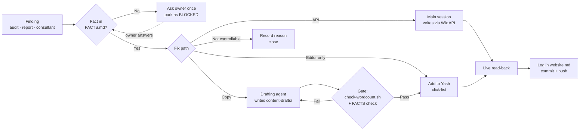
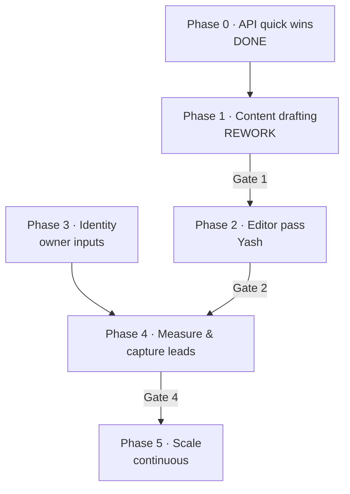
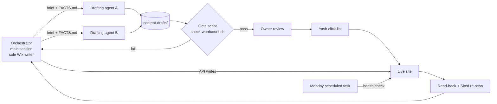

# Varsha Forgings — GEO & Lead-Gen Operating Plan
**v2.0 · 22 Nov 2026** · Replaces v1. Owner and Editor operator: Yash J. Munot (one person) · Chief of staff / architect: Claude

> **New session? Read in this order:** `PLAN.md` (this) → `FACTS.md` (what may be published) → `website.md` (dated log of what's done) → `content-drafts/`. Do nothing until all four are read.

---

## 1. Goal and how we measure it

**Goal:** when a buyer asks an AI engine or Google who makes closed-die forgings, precision machining and assemblies in India, Varsha Forgings is named — and that question turns into an RFQ.

| KPI | Baseline (22 Nov 2026) | Target, Phase 4 exit | Measured by |
|---|---|---|---|
| Sited GEO Readiness Score | 81 / 100 | ≥ 90 | Sited re-scan |
| Sited homepage scorecard | 70 / 100 | ≥ 85 | Sited free scorecard |
| Named in Sited's live AI check | 2 of 4 questions | 3 of 4 | Sited report |
| Pages under 500 words (of 10 crawled) | 7 | 0 | `scripts/check-wordcount.sh` + Sited |
| Search Console 28-day impressions / clicks | Captured by Monday task | +25% | Weekly task |
| RFQ + enquiry form submissions / month | **Not yet tracked** | Baseline set in Phase 4 | Wix Forms API |

The last row is the honest gap: everything so far measures visibility, nothing measures leads. Phase 4 closes it.

### Tracker stack by phase (decided by Claude as chief of staff, 22 Nov 2026)

| Phase | Tracker | Answers | Cost | Cadence |
|---|---|---|---|---|
| 0–2 Build | `scripts/check-wordcount.sh` + Wix API read-back | Did the fix land exactly as specified? | $0 | Every step |
| 0–2 Build | Sited free scorecard (2 per month) | Has the homepage GEO score moved after each Editor pass? | $0 | After each Editor pass |
| 3 Identity | Schema read-back (`sameAs` live) | Can AI link the site to the LinkedIn entity? | $0 | Once, then weekly |
| 4–5 Measure | **Google Search Console** (Wix GSC API) | Which pages and queries earn impressions and clicks | $0 | Weekly (Monday task) |
| 4–5 Measure | **GA4 via Windsor.ai**: referrals from chatgpt.com, perplexity.ai, gemini.google.com, copilot.microsoft.com | Real visits arriving from AI answers, the bridge from visibility to traffic | $0 (connected) | Weekly |
| 4–5 Measure | **Wix Forms submissions API** (RFQ + Contact forms) | **Leads per week.** The KPI everything else serves | $0 | Weekly |
| 0–5 All | **Sited full report** (owner has already paid) | GEO Readiness Score across 10 pages, plus a live OpenAI check of whether Varsha is named in 4 buyer questions | Already paid; owner says usable year-round | After each phase, and at least monthly |

**No new tool sign-ups (owner decision, 22 Nov 2026).** AI-citation tracking comes from Sited's live AI check in each report plus GA4 AI-referral visits. visibility.ai is dropped. Revisit a dedicated citation tracker only if these two prove insufficient after a full quarter. If a Sited re-run ever asks for payment, flag it to the owner before paying.

**Competitor set to track** (from Sited's live AI checks): India Forge Industries · Forgix · Jai Parvati Forge · Microfit Industries · Bharat Forge · Quality Precision Industries · AT Forge · Unity Forgings.

---

## 1A. Sited report — priority view (the report's own order)

Every action in the Sited AI Visibility Report's "Prioritised Action Plan" (22 Nov 2026), in its order, with live status. **Work the open items top to bottom.**

### Quick Wins (report: "this week") — report says these alone take 81 → 90
| # | Report action | Finding | Impact | Status | Next step / owner |
|---|---|---|---|---|---|
| QW1 | sameAs links on homepage Organization schema | F1 | High | ✅ Done, reviewer-verified (LinkedIn) | Add more profiles as they're verified (F15) |
| QW2 | Brand name in homepage title | F5 | Medium | ✅ Done | — |
| QW3 | Publication dates on `/assembly-services`, `/forging-company-aurangabad`, `/company-profile` | F4 | Medium | ◐ Schema `dateModified` done; **visible date pending** | Yash, Phase 2 |
| QW4 | Author byline on `/assembly-services` | F6 | Low | ◐ Schema author done; **visible byline pending** | Yash, Phase 2 |
| QW5 | H1 + ≥ 2 H2 on `/product`, `/electric-vehicles` | F8 | Low | ◐ Drafts have them; **paste pending** | Yash, Phase 2 |
| QW6 | content-security-policy header | F7 | Low | ✕ Not owner-controllable on Wix Classic | Closed; costs ~1 point |

### Medium-Term (report: "this month") — with Quick Wins, report says 97
| # | Report action | Finding | Impact | Status | Next step / owner |
|---|---|---|---|---|---|
| MT1 | Structured data on `/about-1-1`, `/product`, `/electric-vehicles`, `/tool-manufactring` | F3 | Medium | ✅ Done | — |
| MT2 | Expand 7 pages to 500+ words | F2 | Medium | ◐ Drafts gate-passed (560–653 words); **paste pending** | Owner read-through → Yash, Phase 2 |
| MT3 | **Proof and FAQ content: case studies, certifications in prose, customer references** | **F19 (new)** | Medium | ✕ Not started (FAQ schema only) | Owner supplies 1–2 real case studies (problem → part → result). Claude drafts from them |
| MT4 | og:image on pages without one | F9 | Low | ✅ Done (10 crawled pages) | Extend to all 49 in the weekly task |

### Strategic (report: "this quarter")
| # | Report action | Finding | Impact | Status | Next step / owner |
|---|---|---|---|---|---|
| ST1 | Build verified off-site presence (directories, Wikidata, etc.) for sameAs | F15 | High (lifts Brand cap 80 → 100) | ✕ Not started | Yash: IndiaMART / TradeIndia / ExportersIndia listings audit; Claude: Wikidata entry draft |
| ST2 | Topical authority: dated, bylined articles answering buyer questions | F16 | Medium | ◐ 2 blog posts live (precision forging cost; sourcing forgings from India buyer's guide, 23 Nov) | Claude publishes via Blog API, zero Yash. Target 2 per month |
| ST3 | **Downloadable technical resources: capability sheet, spec sheets, traceability docs** | **F20 (new)** | Medium | ✕ Not started | Claude builds a capability-sheet PDF from FACTS.md → owner approves → upload via API |

### Other report items not in its action table (added)
| # | Report item | Finding | Impact | Status | Next step |
|---|---|---|---|---|---|
| X1 | **Article + Author schema** on bylined pages (`/forging-company-aurangabad`, `/company-profile`, `/assembly-services`) | **F21 (new)** | High (report's schema table) | ✅ Done on 3 pages (author = company; no person shown on live pages) | Reviewer to verify |
| X2 | **Privacy policy and terms pages**; contact page linked in main nav | **F22 (new)** | Low (agent readiness 38/100) | ✕ Not started | Claude drafts copy; Yash creates pages (Editor) |
| X3 | **Verify Core Web Vitals** (PageSpeed Insights) and **IndexNow** (Bing Webmaster Tools) | **F23 (new)** | Medium (unverified) | ✕ Not started | Reviewer runs PageSpeed via public API; Bing needs owner login |

**Projected score** (report's own arithmetic): Quick Wins done except CSP ≈ **89** · plus Medium-Term ≈ **96** · Brand stays capped at 80 until ST1 off-site presence is verifiable.

---

## 2. Operating rules

1. **Facts come only from `FACTS.md`.** Not from memory, not from a consultant, not from an agent's draft. A claim not in `FACTS.md` is not published.
2. **One writer to Wix.** Only the main session writes to the live site through the API. Agents draft into `content-drafts/` and never touch Wix. This prevents two agents overwriting the same page's tags (Wix replaces the full tag set on every write).
3. **Every phase has an exit gate, checked by a script or a live read-back — never by an agent's own report.** An agent saying "500+ words" is a claim; `check-wordcount.sh` is evidence.
4. **Yash gets one consolidated click-list per phase,** with exact paths, never a drip of single requests.
5. **Log every change** in `website.md` with date, method (API / Editor / draft) and the gate result. Commit and push after every phase.
6. **Spend over $50 needs the owner's explicit yes** (one-time or recurring).

---

## 3. Process flow — how any finding is handled

---

## 4. Phases and gates

Phase 3 runs in parallel with 1 and 2 — it only waits on your answers.

| Phase | Scope | Exit gate | Owner | Status |
|---|---|---|---|---|
| **0 · Quick wins** | Homepage title with brand (F5) · Organization + Service schema on 4 pages (F3) · `dateModified` + author in schema (F4, F6) · og:image on 10 pages (F9) · homepage FAQ schema · consultant facts folded into 5 pages · precision-forging-cost blog post | API read-back shows every tag present | Claude | ✅ Passed |
| **1 · Content drafting** | Expanded copy for 7 thin pages (F2), using `FACTS.md` | `scripts/check-wordcount.sh 550` exits 0 · H1 + ≥ 2 H2 per page · every claim traceable to `FACTS.md` · owner reads and approves | Drafting agents → Claude verifies → owner approves | 🔁 **Failed first attempt (0/7 passed). Rework running.** |
| **2 · Editor pass** | One sitting: paste 7 pages of copy · H1/H2 on `/product`, `/electric-vehicles` (F8) · visible date on 3 pages (F4) · visible byline on `/assembly-services` (F6) · fix social icons pointing to Wix's own accounts (F10) · certifications body paste, footer email typo, 2 body typos, Awards publish + nav (F12) | Live fetch: every crawled page ≥ 500 words, has an H1, no `facebook.com/wix` links | Yash | Waiting on Gate 1 |
| **3 · Identity** | sameAs links (F1) · CIN (F11) · LinkedIn company page exists and is verified (F15) · resolve F18 | `sameAs` array live in homepage Organization schema | Owner supplies URLs → Claude writes | ⏳ Waiting on owner |
| **4 · Measure & capture** | Sited re-scan · choose AI-visibility tracker (F17) · RFQ form baseline from Wix Forms API · fold lead count into Monday task | Sited ≥ 90 · lead baseline recorded · tracker live | Claude + owner decision | Not started |
| **5 · Scale** | Monthly blog articles via API (no Yash) · off-site profiles (directories, Wikidata) · Dynamic CMS page template (F14) · GBP + Windsor.ai (F13) | Rolling monthly review against §1 KPIs | Claude + Yash | Not started |

---

## 5. Findings register

| ID | Finding | Source | Impact | Phase | Status |
|---|---|---|---|---|---|
| F1 | No `sameAs` links | Sited #1 | High · 30 pts | 3 | **Unblocked:** LinkedIn URL supplied, executor dispatched |
| F2 | 7 pages < 500 words | Sited #2 | Med · 17 pts | 1 → 2 | Rework |
| F3 | 4 pages without Organization/Service schema | Sited #3 | Med · 20 pts | 0 | ✅ |
| F4 | No publication dates (3 pages) | Sited #4 | Med · 10 pts | 0 schema ✅ · 2 visible | Half done |
| F5 | Homepage title omits brand | Sited #5 | Med · 10 pts | 0 | ✅ |
| F6 | No byline, `/assembly-services` | Sited #6 | Low · 5 pts | 0 schema ✅ · 2 visible | Half done |
| F7 | No content-security-policy header | Sited #7 | Low · 5 pts | — | Closed: Wix-controlled; raise with Wix support only if score matters |
| F8 | No H1 on `/product`, `/electric-vehicles` | Sited #8 | Low · 3 pts | 2 | Pending |
| F9 | og:image missing | Sited | Low | 0 | ✅ |
| F10 | Social icons link to `facebook.com/wix`, `instagram.com/wix` | Found in audit | Trust bug | 2 | Pending |
| F11 | CIN for Organization schema | Master Log | — | — | **Closed:** owner decision, CIN is never published |
| F12 | Certifications paste, footer typo, body typos, Awards nav | Master Log | — | 2 | Pending |
| F13 | GBP ownership + Windsor.ai | Master Log | — | 5 | Pending |
| F14 | Dynamic CMS page template | This session | Removes Editor bottleneck | 5 | Not scheduled |
| F15 | Off-site presence (LinkedIn, Wikidata, directories) | Sited strategic | Lifts Brand cap 80 → 100 | 3 / 5 | Not started |
| F16 | Topical content calendar | Sited strategic | Ongoing citations | 5 | Not started |
| F17 | Ongoing AI-visibility tracker | This session | Measurement | 4 | **Closed:** no new sign-ups. Sited (already paid) + GA4 AI-referrals |
| F19 | Proof content: case studies, certifications in prose, customer references | Sited MT3 | Med | 4 | Needs 1–2 real case studies from owner |
| F20 | Downloadable technical resources (zero found) | Sited ST3 | Med | 5 | Not started |
| F21 | Article + Author schema on bylined pages | Sited schema table | High | 3 | ✅ Done |
| F22 | Privacy policy + terms pages; contact in main nav | Sited agent readiness | Low | 2 | Not started |
| F24 | **Site-wide fabricated / contradictory claims** (weights, tolerances, capacity, compliance, China claims; machine counts on 7 pages) | 49-page audit | **High: trust + AI confidence** | 2 | Owner answers `OWNER-CONFIRM.md` → Yash `PHASE2-YASH-CLICKLIST.md` |
| F25 | **Lead-critical: footer + contact mailto `varshaforging.com` typo** | 49-page audit | **High: enquiries may bounce** | 2 | Block 1 of Yash's click-list |
| F23 | Verify Core Web Vitals + IndexNow | Sited technical (unverified) | Med | 4 | Not started |
| F26 | **Visible-text corrections without Editor work** | Owner decision 22 Nov 2026 | Removes Yash's clerical Editor work | 2 | **Interim live:** Custom Embed layer (pilot verified, batch 1 in flight). **Server-side:** Velo + GitHub, waiting on Yash's connection |
| F27 | Redirect `/forged-machined-components` → `/alloy-steel-forgings` hides page `arrpe`; 2 redirects point at a redirected path | Executor finding | Medium | 2 | **Owner-approved:** re-point to `/forged-machined-components-vf`; fix the 2 chained redirects. Executor dispatched |
| F28 | Thin live pages `/alloy-steel-forgings` (~105 words) and `/forged-machined-components-vf` (~75 words), with wrong weight and in-house broaching in the body | Redirect review | Medium | 1 → F26 layer | Add to the content-drafting queue |
| F18 | Machine counts on the live site (e.g. Pune "60 CNC turning centers, 17 VMCs") | Cross-check this session | Accuracy risk | 3 | **Owner rule: no machine counts anywhere.** Executor dispatched to sweep all pages |

---

## 6. Multi-agent execution model

**Model rule (owner, 22 Nov 2026):** Opus plans and dispatches · Sonnet executes · Haiku reads and reviews. The agent definitions live in `.claude/agents/`; the rule is also in `CLAUDE.md`.

| Role | Who | Model | Can do | Cannot do |
|---|---|---|---|---|
| Orchestrator | Main session | **Opus** | Plan, brief, dispatch, own `PLAN.md` / `FACTS.md`, log, commit | Do bulk execution itself |
| Executor | `executor` agent | **Sonnet** | Draft copy, edit repo files, Wix API writes (one at a time) | Change the plan, invent facts, mark own work done |
| Reviewer | `reviewer` agent | **Haiku** | Read, audit, run gates, Wix read-back (GET only), PASS/FAIL with evidence | Edit anything |
| Gate | `scripts/check-wordcount.sh` + live read-back | — | Pass/fail on measured evidence | — |
| Operator | Yash | Editor click-work from one consolidated list | Decide what to build |
| Monitor | Monday 8:13 IST scheduled task | Re-check SEO tags, GSC, cert wording; fix gaps the same way | Send external comms, delete, unpublish |

**Briefing standard for every drafting agent:** target page and current word count · `FACTS.md` as the only fact source · ≥ 550 words of visible copy, H1 + ≥ 2 H2, question-style headings · run `scripts/check-wordcount.sh` and iterate until it passes · return the measured counts, not an estimate.

---

## 7. Risks and fallbacks

| Risk | Fallback |
|---|---|
| Wix API access drops | Monday task logs the failure, nothing corrupts; resume next session from `website.md` |
| Agent invents a fact | `FACTS.md` rule + owner review at Gate 1; anything not in `FACTS.md` is struck |
| Yash unavailable for Phase 2 | Content still ships as dated, bylined Blog posts via API (zero Editor work) — weaker than fixing the core pages, but not blocked |
| Schema tag exceeds Wix's 4,096-byte limit | Compact JSON, trim redundant fields (done once on `/forging-company-maharashtra`) |
| Sited score doesn't move after fixes | Re-scan checks only 10 pages; verify live HTML directly before assuming the fix failed |
