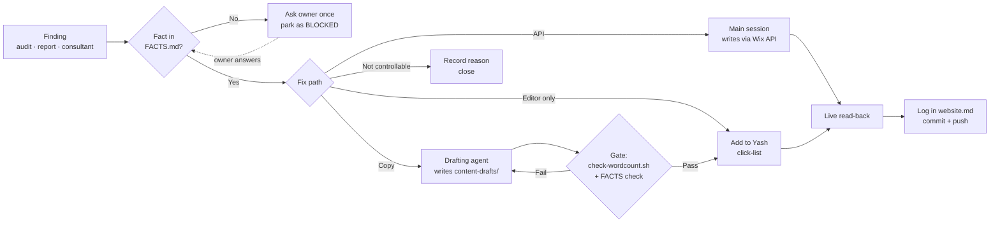
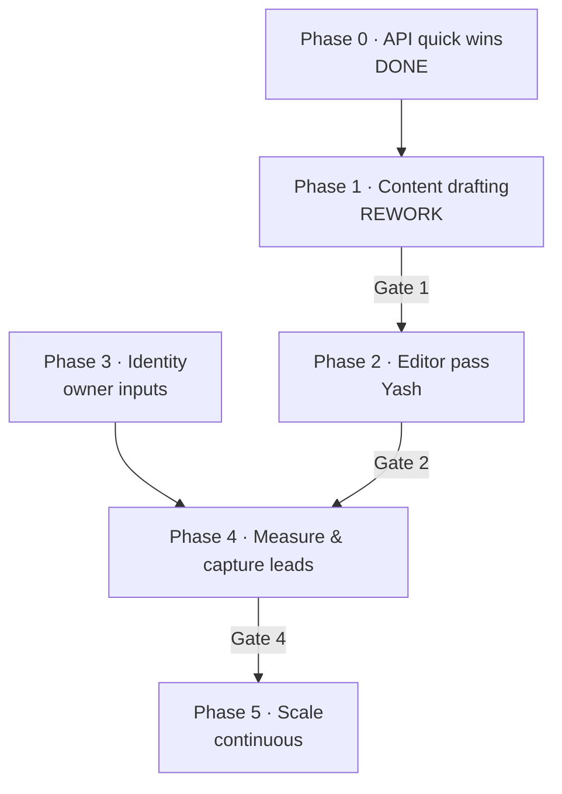
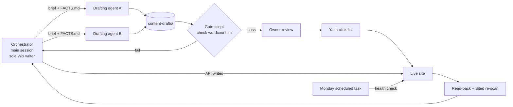

# Varsha Forgings — GEO & Lead-Gen Operating Plan
**v2.0 · 22 Nov 2026** · Replaces v1. Owner: Varsha Forgings · Architect: Claude · Editor operator: Yash

> **New session? Read in this order:** `PLAN.md` (this) → `FACTS.md` (what may be published) → `website.md` (dated log of what's done) → `content-drafts/`. Do nothing until all four are read.

---

## 1. Goal and how we measure it

**Goal:** when a buyer asks an AI engine or Google who makes closed-die forgings, precision machining and assemblies in India, Varsha Forgings is named — and that question turns into an RFQ.

| KPI | Baseline (22 Nov 2026) | Target, Phase 4 exit | Measured by |
|---|---|---|---|
| Sited GEO Readiness Score | 81 / 100 | ≥ 90 | Sited re-scan |
| Sited homepage scorecard | 70 / 100 | ≥ 85 | Sited free scorecard |
| Named in Sited's live AI check | 2 of 4 questions | 3 of 4 | Sited report |
| Pages under 500 words (of 10 crawled) | 7 | 0 | `scripts/check-wordcount.sh` + Sited |
| Search Console 28-day impressions / clicks | Captured by Monday task | +25% | Weekly task |
| RFQ + enquiry form submissions / month | **Not yet tracked** | Baseline set in Phase 4 | Wix Forms API |

The last row is the honest gap: everything so far measures visibility, nothing measures leads. Phase 4 closes it.

---

## 2. Operating rules

1. **Facts come only from `FACTS.md`.** Not from memory, not from a consultant, not from an agent's draft. A claim not in `FACTS.md` is not published.
2. **One writer to Wix.** Only the main session writes to the live site through the API. Agents draft into `content-drafts/` and never touch Wix. This prevents two agents overwriting the same page's tags (Wix replaces the full tag set on every write).
3. **Every phase has an exit gate, checked by a script or a live read-back — never by an agent's own report.** An agent saying "500+ words" is a claim; `check-wordcount.sh` is evidence.
4. **Yash gets one consolidated click-list per phase,** with exact paths, never a drip of single requests.
5. **Log every change** in `website.md` with date, method (API / Editor / draft) and the gate result. Commit and push after every phase.
6. **Spend over $50 needs the owner's explicit yes** (one-time or recurring).

---

## 3. Process flow — how any finding is handled

---

## 4. Phases and gates

Phase 3 runs in parallel with 1 and 2 — it only waits on your answers.

| Phase | Scope | Exit gate | Owner | Status |
|---|---|---|---|---|
| **0 · Quick wins** | Homepage title with brand (F5) · Organization + Service schema on 4 pages (F3) · `dateModified` + author in schema (F4, F6) · og:image on 10 pages (F9) · homepage FAQ schema · consultant facts folded into 5 pages · precision-forging-cost blog post | API read-back shows every tag present | Claude | ✅ Passed |
| **1 · Content drafting** | Expanded copy for 7 thin pages (F2), using `FACTS.md` | `scripts/check-wordcount.sh 550` exits 0 · H1 + ≥ 2 H2 per page · every claim traceable to `FACTS.md` · owner reads and approves | Drafting agents → Claude verifies → owner approves | 🔁 **Failed first attempt (0/7 passed). Rework running.** |
| **2 · Editor pass** | One sitting: paste 7 pages of copy · H1/H2 on `/product`, `/electric-vehicles` (F8) · visible date on 3 pages (F4) · visible byline on `/assembly-services` (F6) · fix social icons pointing to Wix's own accounts (F10) · certifications body paste, footer email typo, 2 body typos, Awards publish + nav (F12) | Live fetch: every crawled page ≥ 500 words, has an H1, no `facebook.com/wix` links | Yash | Waiting on Gate 1 |
| **3 · Identity** | sameAs links (F1) · CIN (F11) · LinkedIn company page exists and is verified (F15) · resolve F18 | `sameAs` array live in homepage Organization schema | Owner supplies URLs → Claude writes | ⏳ Waiting on owner |
| **4 · Measure & capture** | Sited re-scan · choose AI-visibility tracker (F17) · RFQ form baseline from Wix Forms API · fold lead count into Monday task | Sited ≥ 90 · lead baseline recorded · tracker live | Claude + owner decision | Not started |
| **5 · Scale** | Monthly blog articles via API (no Yash) · off-site profiles (directories, Wikidata) · Dynamic CMS page template (F14) · GBP + Windsor.ai (F13) | Rolling monthly review against §1 KPIs | Claude + Yash | Not started |

---

## 5. Findings register

| ID | Finding | Source | Impact | Phase | Status |
|---|---|---|---|---|---|
| F1 | No `sameAs` links | Sited #1 | High · 30 pts | 3 | Blocked: need real profile URLs |
| F2 | 7 pages < 500 words | Sited #2 | Med · 17 pts | 1 → 2 | Rework |
| F3 | 4 pages without Organization/Service schema | Sited #3 | Med · 20 pts | 0 | ✅ |
| F4 | No publication dates (3 pages) | Sited #4 | Med · 10 pts | 0 schema ✅ · 2 visible | Half done |
| F5 | Homepage title omits brand | Sited #5 | Med · 10 pts | 0 | ✅ |
| F6 | No byline, `/assembly-services` | Sited #6 | Low · 5 pts | 0 schema ✅ · 2 visible | Half done |
| F7 | No content-security-policy header | Sited #7 | Low · 5 pts | — | Closed: Wix-controlled; raise with Wix support only if score matters |
| F8 | No H1 on `/product`, `/electric-vehicles` | Sited #8 | Low · 3 pts | 2 | Pending |
| F9 | og:image missing | Sited | Low | 0 | ✅ |
| F10 | Social icons link to `facebook.com/wix`, `instagram.com/wix` | Found in audit | Trust bug | 2 | Pending |
| F11 | CIN for Organization schema | Master Log | — | 3 | Blocked: owner said leave out for now |
| F12 | Certifications paste, footer typo, body typos, Awards nav | Master Log | — | 2 | Pending |
| F13 | GBP ownership + Windsor.ai | Master Log | — | 5 | Pending |
| F14 | Dynamic CMS page template | This session | Removes Editor bottleneck | 5 | Not scheduled |
| F15 | Off-site presence (LinkedIn, Wikidata, directories) | Sited strategic | Lifts Brand cap 80 → 100 | 3 / 5 | Not started |
| F16 | Topical content calendar | Sited strategic | Ongoing citations | 5 | Not started |
| F17 | Ongoing AI-visibility tracker | This session | Measurement | 4 | Owner choice: Rankscale $17 / visibility.ai $39 |
| **F18** | **Live `/forging-manufacturer-pune` FAQ says the Pune plant "houses over 60 CNC turning centers, 17 VMCs" — the company deck lists 60 CNC / 17 VMC as *dedicated vendor* capacity, not in-house** | Cross-check this session | **Accuracy risk** | 3 | **Needs owner confirmation before anything is changed** |

---

## 6. Multi-agent execution model

| Role | Who | Can do | Cannot do |
|---|---|---|---|
| Orchestrator | Main session | Read/write Wix via API, run gates, update `PLAN.md` / `website.md`, brief agents | — |
| Drafting agents | Background forks, one per page group | Read `FACTS.md`, write `content-drafts/`, self-run the gate script | Touch Wix, invent facts, mark their own work complete |
| Gate | `scripts/check-wordcount.sh` + live read-back | Pass/fail on measured evidence | — |
| Operator | Yash | Editor click-work from one consolidated list | Decide what to build |
| Monitor | Monday 8:13 IST scheduled task | Re-check SEO tags, GSC, cert wording; fix gaps the same way | Send external comms, delete, unpublish |

**Briefing standard for every drafting agent:** target page and current word count · `FACTS.md` as the only fact source · ≥ 550 words of visible copy, H1 + ≥ 2 H2, question-style headings · run `scripts/check-wordcount.sh` and iterate until it passes · return the measured counts, not an estimate.

---

## 7. Risks and fallbacks

| Risk | Fallback |
|---|---|
| Wix API access drops | Monday task logs the failure, nothing corrupts; resume next session from `website.md` |
| Agent invents a fact | `FACTS.md` rule + owner review at Gate 1; anything not in `FACTS.md` is struck |
| Yash unavailable for Phase 2 | Content still ships as dated, bylined Blog posts via API (zero Editor work) — weaker than fixing the core pages, but not blocked |
| Schema tag exceeds Wix's 4,096-byte limit | Compact JSON, trim redundant fields (done once on `/forging-company-maharashtra`) |
| Sited score doesn't move after fixes | Re-scan checks only 10 pages; verify live HTML directly before assuming the fix failed |
